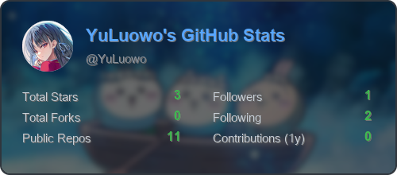
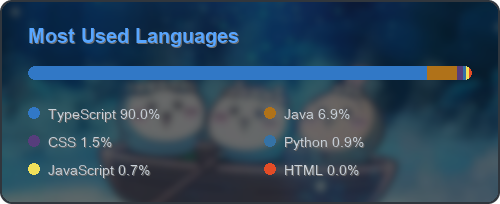

# github-custom-badge

Generate your own GitHub stats cards with Python + Pillow. Data comes from the
GitHub API, and GitHub Actions refreshes the images once a week at 00:00 UTC.




## Features

- Fetches profile, repositories and per-repository language bytes via the GitHub REST API
- Fetches the last year of contributions via the GitHub GraphQL API (token required)
- Renders two cards with Pillow:
  - `stats.png`: avatar, stars, forks, repos, followers, following, contributions
  - `languages.png`: stacked language bar with a legend using GitHub language colors
- Custom background image support: drop your own picture into `assets/` and the
  stats are drawn on top of it
- Built-in `dark` / `light` / `dracula` themes
- Scheduled GitHub Actions workflow that commits the updated images automatically

## Project structure

```
.github/workflows/update-stats.yml
assets/background.png
src/config.py
src/github_api.py
src/renderer.py
src/main.py
output/
```

## Custom background

Put any image into the `assets/` folder and point `BACKGROUND_IMAGE` at its
file name (default: `background.png`). The image is scaled to cover the card,
cropped from the center, blurred slightly and dimmed with a translucent overlay
so the text stays readable. Rounded corners are applied automatically and the
corners outside the card are saved as transparent pixels.

```bash
export BACKGROUND_IMAGE=background.png
export BACKGROUND_BLUR=2        # 0 disables the blur
export BACKGROUND_OVERLAY=150   # 0-255, higher means darker/stronger overlay
```

Use `LANGS_BACKGROUND_IMAGE` if you want a different background for the
language card. If the file does not exist, the card falls back to the solid
theme background.

## Run locally

```bash
python -m venv .venv
source .venv/bin/activate          # Windows: .venv\Scripts\activate
pip install -r requirements.txt

export GH_USERNAME=YuLuowo
export GH_TOKEN=ghp_xxx            # optional, but recommended for a higher rate limit
python src/main.py
```

The generated images are written to `output/`.

## Configuration (environment variables)

| Variable | Default | Description |
| --- | --- | --- |
| `GH_USERNAME` | `YuLuowo` | GitHub account to generate the stats for |
| `GH_TOKEN` | empty | Personal access token; without it only the anonymous rate limit (60 req/h) is available and contributions cannot be read |
| `THEME` | `dark` | `dark` / `light` / `dracula` |
| `TOP_LANGUAGES` | `6` | Number of languages shown on the language card |
| `EXCLUDE_LANGS` | empty | Comma separated languages to skip, e.g. `HTML,CSS` |
| `EXCLUDE_REPOS` | empty | Comma separated repository names to skip |
| `INCLUDE_FORKS` | `false` | Include forked repositories in the statistics |
| `ASSETS_DIR` | `assets` | Folder that holds the background images |
| `BACKGROUND_IMAGE` | `background.png` | Background for the stats card |
| `LANGS_BACKGROUND_IMAGE` | same as `BACKGROUND_IMAGE` | Background for the language card |
| `BACKGROUND_BLUR` | `2` | Gaussian blur radius applied to the background |
| `BACKGROUND_OVERLAY` | `150` | Overlay opacity (0-255) drawn over the background |
| `OUTPUT_DIR` | `output` | Output folder |

## Automatic updates

The schedule in `.github/workflows/update-stats.yml`:

```yaml
schedule:
  - cron: "0 0 * * 0"
```

It runs every Sunday at 00:00 UTC. The workflow installs the dependencies, runs
`src/main.py` and commits the images back to the repository only when they
changed. You can also trigger it manually with **Run workflow** on the Actions
page.

> The workflow uses `github.token` by default. To include contributions from
> private repositories, create a PAT with `read:user` and `repo` scopes and
> store it as the repository secret `GH_TOKEN`.

## Use it in your README

```markdown


```

## License

[MIT](LICENSE)
